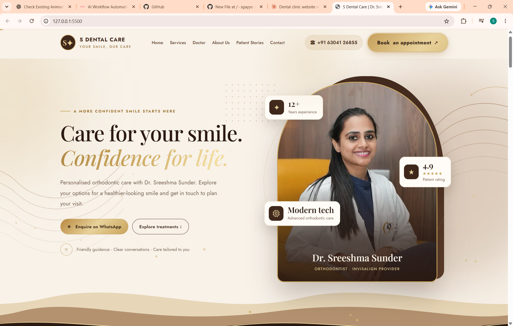

# S Dental Care | Dental Clinic Website

A modern, responsive website built for **S Dental Care**, featuring Dr. Sreeshma Sunder, Orthodontist and Invisalign Provider, located in Moosapet X Roads, Hyderabad, India.

<p align="center">
  <a href="https://sgayye-6612.github.io/s-dental-care-website/">
    <strong>🌐 View Live Website</strong>
  </a>
</p>

---

## Table of Contents

- [Project Overview](#project-overview)
- [Live Preview](#live-preview)
- [Key Features](#key-features)
- [Website Sections](#website-sections)
- [Technology Stack](#technology-stack)
- [Project Structure](#project-structure)
- [Getting Started](#getting-started)
- [Clinic Information](#clinic-information)
- [Developer](#developer)

---

## Project Overview

S Dental Care is a clinic website designed to establish a professional online presence, showcase dental treatments, introduce the doctor, and make clinic information accessible to prospective patients.

The website combines a clean visual design with interactive elements, patient stories, clinic photography, and an integrated map.

**Project type:** Frontend Web Development  
**Architecture:** Single-page website  
**Status:** Deployed

## Live Preview

<p align="center">
  <a href="https://sgayye-6612.github.io/s-dental-care-website/">
    
  </a>
</p>

<p align="center">
  <em>Homepage — Care for your smile</em>
</p>

---

## Key Features

| Feature | Description |
|---|---|
| Responsive Layout | Website layout adapted for different screen sizes |
| Treatment Showcase | Dedicated section for dental services |
| Doctor Profile | Professional introduction to the orthodontist |
| Interactive 3D Tooth | Three-dimensional visualization using Three.js |
| Patient Stories | Dedicated area for patient experiences |
| Clinic Gallery | Clinic photographs and video content |
| Appointment Enquiries | Convenient access to contact and appointment information |
| Google Maps | Integrated clinic location |
| Animations | Visual interactions and motion effects |

---

## Website Sections

### 1. Home

A welcoming landing page introducing the clinic and its dental care services.

### 2. Dental Treatments

A dedicated section presenting the treatments offered by the clinic.

### 3. Doctor Profile

Introduces Dr. Sreeshma Sunder, highlighting her orthodontic practice and Invisalign Provider designation.

### 4. About Us — Interactive 3D Tooth

Uses Three.js to create a three-dimensional visual element that adds depth to the website experience.

### 5. Patient Stories

A section dedicated to patient experiences and smile transformations.

### 6. Inside the Clinic

A visual gallery showcasing the clinic environment.

### 7. Real Smiles & Videos

Displays visual content featuring smiles and clinic videos.

### 8. Contact & Location

Provides contact details, appointment enquiry options, and an embedded Google Map.

---

## Website Gallery

### Treatments & Doctor Profile

<table>
  <tr>
    <td width="50%">
      
      <p align="center"><strong>Dental Treatments</strong></p>
    </td>
    <td width="50%">
      
      <p align="center"><strong>Doctor Profile</strong></p>
    </td>
  </tr>
</table>

### About Us & Patient Stories

<table>
  <tr>
    <td width="50%">
      
      <p align="center"><strong>About Us & 3D Tooth</strong></p>
    </td>
    <td width="50%">
      
      <p align="center"><strong>Patient Stories</strong></p>
    </td>
  </tr>
</table>

### Clinic Gallery & Videos

<table>
  <tr>
    <td width="50%">
      
      <p align="center"><strong>Inside the Clinic</strong></p>
    </td>
    <td width="50%">
      
      <p align="center"><strong>Real Smiles & Videos</strong></p>
    </td>
  </tr>
</table>

### Contact & Location

<table>
  <tr>
    <td width="50%">
      
      <p align="center"><strong>Contact</strong></p>
    </td>
    <td width="50%">
      
      <p align="center"><strong>Map & Footer</strong></p>
    </td>
  </tr>
</table>

---

## Technology Stack

| Technology | Purpose |
|---|---|
| HTML5 | Page structure and semantic content |
| CSS3 | Layout, styling, animations, and responsive design |
| JavaScript | Interactive behaviour and dynamic elements |
| Three.js | 3D tooth visualization |
| Google Fonts | Typography using Playfair Display and Jost |
| Google Maps | Clinic location and navigation |

---

## Project Structure

```text
s-dental-care-website/
│
├── index.html
│   └── Website structure, styles, and JavaScript
│
├── images/
│   ├── p1.png
│   ├── Screenshot 2026-10-28 214722.png
│   ├── Screenshot 2026-10-28 214742.png
│   ├── Screenshot 2026-10-28 214759.png
│   ├── Screenshot 2026-10-28 214816.png
│   ├── Screenshot 2026-10-28 214822.png
│   ├── Screenshot 2026-10-28 214830.png
│   ├── Screenshot 2026-10-28 214839.png
│   └── Screenshot 2026-10-28 214849.png
│
└── README.md
    └── Project documentation
```

*Note: The filenames above describe the intended assets. Keep the actual filenames in your repository unchanged unless you update the corresponding references.*

---

## Getting Started

### Prerequisites

- [Visual Studio Code](https://code.visualstudio.com/)
- [Git](https://git-scm.com/)
- Live Server extension for VS Code

### 1. Clone the repository

```bash
git clone https://github.com/sgayye-6612/s-dental-care-website.git
```

### 2. Navigate to the project

```bash
cd s-dental-care-website
```

### 3. Open in Visual Studio Code

```bash
code .
```

### 4. Run the website

1. Open `index.html`.
2. Right-click inside the editor.
3. Select **Open with Live Server**.
4. View the website in your browser.

No build step is required for the basic HTML, CSS, and JavaScript setup.

---

## Clinic Information

**S Dental Care**

| Detail | Information |
|---|---|
| Doctor | Dr. Sreeshma Sunder |
| Specialty | Orthodontist · Invisalign Provider |
| Location | Moosapet X Roads, Hyderabad, Telangana, India |
| Phone / WhatsApp | +91 63041 26855 |
| Email | sdental332@gmail.com |
| Instagram | [@s_dental_care](https://www.instagram.com/s_dental_care/) |

---

## Developer

**Sahithi Gayye**  
AI Engineer | Full Stack Developer

- GitHub: [@sgayye-6612](https://github.com/sgayye-6612)
- Live Project: [S Dental Care](https://sgayye-6612.github.io/s-dental-care-website/)

---

## License

This repository showcases a website project developed for S Dental Care. Clinic branding, photographs, and other third-party assets remain the property of their respective owners.

---

<p align="center">
  <strong>S Dental Care — Care for your smile.</strong>
</p>
